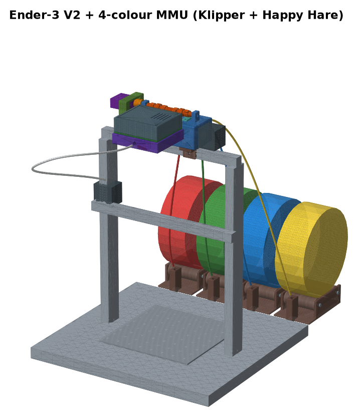
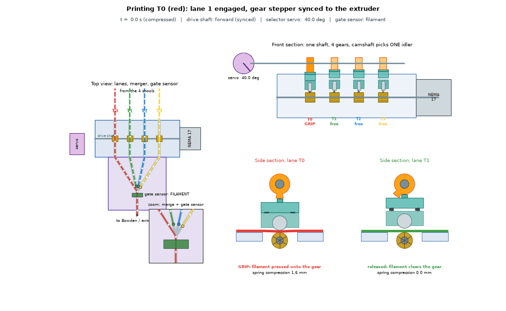
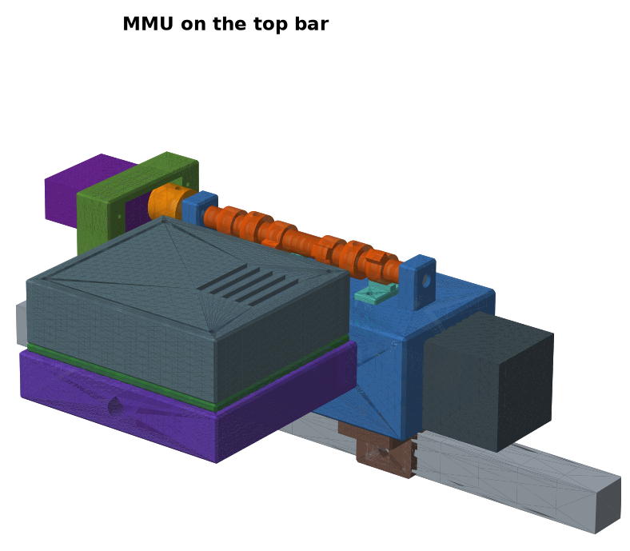
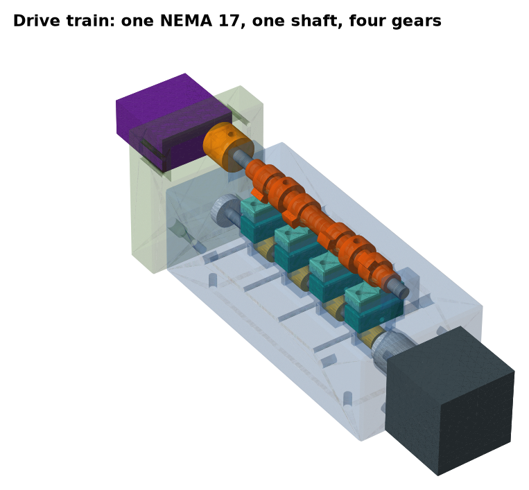
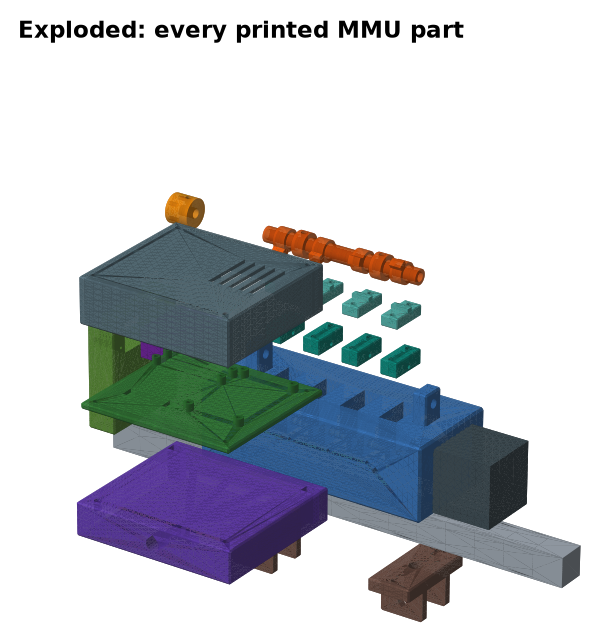
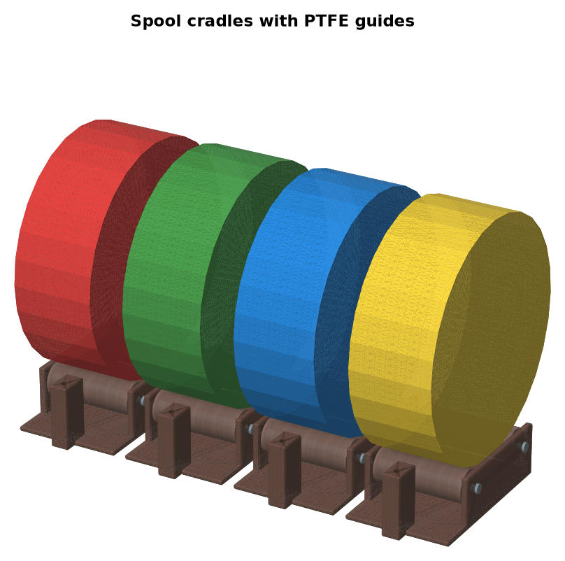

# Ender-3 V2 MMU — a printable 4-colour unit for Klipper + Happy Hare

<p align="center">
  
</p>

<p align="center">
  
  
  
  
</p>

A home-printable, **4-lane multi-material unit** for the Creality **Ender-3 V2**.
One NEMA 17 drives four filament lanes through a single shaft, a servo camshaft
picks the lane, and **Happy Hare** on **Klipper** runs the colour changes.
Everything is generated from one parametric Python file and checked by
assembly audits, printability tests and a colour-change simulation.

> **Status:** the design is complete and every automated check passes, but
> **nothing has been printed or bench-tested yet**. Treat it as a
> well-checked prototype: print the fit coupon and the calibration set first.
> See [PREMORTEM.md](PREMORTEM.md) for what can still go wrong.

---

## How a colour change works

<p align="center">
  
</p>

| Step | What happens |
|---|---|
| **Printing** | The selected lane's idler is pressed onto its gear; the gear stepper runs **synced** with the extruder. |
| **Tip forming** | Happy Hare shapes the filament tip in the hotend (no cutter needed). |
| **Unload** | The shared shaft runs backwards and pulls the old filament out of the Bowden and the merger, until the **gate sensor** clears; it parks 16 mm behind the sensor, in its own lane. |
| **Select** | The MG996R turns the camshaft (40 / 75 / 110 / 145° = lanes 1–4). The gear is stopped while it moves. |
| **Load** | The shaft runs forward: the new filament reaches the gate sensor, then a fast Bowden move to the extruder, which takes over to the nozzle. |
| **Idle lanes** | All four gears turn with the shaft, but idle filament rests **0.2 mm above** the gear teeth, so it never moves. |

---

## The design

<table>
<tr>
<td width="50%"><br><b>On the top bar.</b> Body with four lanes, servo + camshaft on top, NEMA 17 on the side, merger and covered electronics bay in front.</td>
<td width="50%"><br><b>Drive train</b> (body see-through). One NEMA 17 → 5 mm D-shaft → four MK8 gears. The camshaft presses one spring-loaded idler at a time.</td>
</tr>
<tr>
<td><br><b>Exploded.</b> Body, 4 idler blocks + 4 followers, camshaft, servo mount + coupler, merger, electronics plate + cover, top-bar clamps.</td>
<td><br><b>Spool cradles.</b> Each spool rolls on two 608-bearing rollers; an angled guide feeds a PTFE tube up to its MMU inlet.</td>
</tr>
</table>

**Key features**

- **Per-lane drive gears on one shaft** (PicoMMU / ERCF style) — one stepper for four colours.
- **Spring-loaded idlers:** cam → follower → preload springs → bearing; grip comes from springs, not tight tolerances.
- **Servo selector** inside 0–160°, with ±8° of error tolerance per lane.
- **Gate sensor** (roller microswitch, 1.9 mm of travel) where the lanes merge; PTFE-lined merger.
- **No Marlin hacks:** Klipper on the Ender board, a Raspberry Pi Pico as the MMU controller, Happy Hare's supported *Type-A, servo selector* class.
- **Printable without supports** (except the camshaft lobes): teardrop holes, insert-ready bores, a `fit_coupon` to tune hole sizes first.

---

## Checked before printing

Every number in the CAD feeds three layers of checks:

| Layer | What it checks | Run |
|---|---|---|
| **Assembly audit** (80 checks) | No part overlaps, every filament path open and enclosed, cam engages exactly one lane per angle, PTFE bend radius ≥ 40 mm, Bowden slack over full Z travel, envelope fits the Ender | `cad/check_mmu.py` |
| **Printability tests** | Ray-cast wall thickness ≥ 1.2 mm, overhang/bridge limits in print orientation, ≥ 0.2 mm clearance on every sliding fit, BOM matches the CAD | `pytest tests/test_printability.py` |
| **Mechanism tests** | Grip 10–30 N, servo torque margin, gear holding force, lane angles vs servo range | `pytest tests/test_mechanism.py` |
| **Colour-change simulation** | Idle-lane clearance, filament bending strain, grip vs PTFE friction (capstan model, PLA + PETG), servo sweep, merger junction, all 12 T→T changes step by step | `python sim/colour_change.py` |

Simulation highlights (current design):

| Result | Value |
|---|---|
| Idle filament clearance to the turning gears | 0.20 mm |
| Filament strain when pressed onto the gear | 0.82 % (PLA yields at ~2.5 %) |
| Traction / drag, load & unload | 3.1–3.4× (still 1.9× at pessimistic friction) |
| Servo error tolerated per lane | ±8.2° |
| Colour changes simulated | 12 / 12, ~56 s each (mostly the Ender's long extruder → nozzle path) |

The simulation earlier caught real flaws — idle lanes dragged by the shared
gears, too little grip for the PTFE friction, tips parked too far from the
gate sensor — all fixed and now guarded by tests.

---

## Build it

1. **Klipper on the plain Ender first** — flash the board, KIAUH on the Pi,
   KlipperScreen on your display, print a good single-colour cube.
   → [FIRMWARE.md](FIRMWARE.md)
2. **Measure your machine** (gates G1–G8). → [MEASUREMENTS.md](MEASUREMENTS.md)
3. **Buy the parts** (~$120–135 + Pi you already own). → [BOM.md](BOM.md)
4. **Print** in PETG, 0.2 mm, 4 walls, 40 % gyroid, in this order:
   `fit_coupon` → calibration set (`mmu_body`, one idler block + follower,
   `selector_camshaft`) → everything else (~875 g). STLs are in [`stl/`](stl).
5. **Bench-test, mount, calibrate** with Happy Hare. → [PLAN.md](PLAN.md)

---

## Explore the model

```bash
python3 -m venv .venv && .venv/bin/pip install -r requirements.txt
.venv/bin/python cad/build_mmu.py          # regenerate STLs + viewer/manifest.json
.venv/bin/python cad/check_mmu.py          # assembly audit
.venv/bin/python -m pytest -q tests        # printability, mechanism, simulation tests
.venv/bin/python sim/colour_change.py      # simulation report
.venv/bin/python sim/animate_change.py     # renders/colour_change.gif
.venv/bin/python tools/render_preview.py   # renders/0*.png
python3 -m http.server                     # interactive 3D viewer: http://localhost:8000/viewer/
```

The viewer (Three.js, needs WebGL) has exploded view, per-part toggles,
hover labels and a tool-change demo.

## Repository layout

```
cad/build_mmu.py        parametric build123d source: every part, assembly, routes
cad/check_mmu.py        assembly + mechanism audit
sim/colour_change.py    colour-change simulation
sim/animate_change.py   mechanism animation (GIF)
tests/                  printability, mechanism and simulation tests
stl/                    printable parts (generated)
viewer/                 Three.js viewer + manifest.json (generated)
renders/                README images + animation (generated)
tools/render_preview.py shaded preview renders (matplotlib)
render_mmu.py           optional Blender renders
docs/history/           earlier design reviews
PLAN.md · FIRMWARE.md · MEASUREMENTS.md · BOM.md · PREMORTEM.md
```

## Credits

Built on ideas from the community: **PicoMMU** (servo-selector, shared drive
stepper), **ERCF** (per-gate gears on one shaft), and **Happy Hare** by
moggieuk, which runs the whole thing. Designed for the Creality Ender-3 V2.
